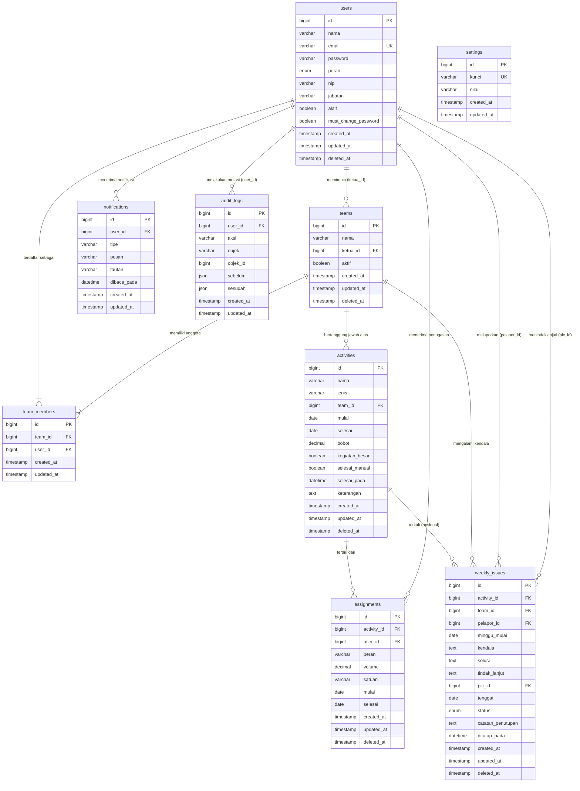

# Diagram Hubungan Entitas (ERD)
**Aplikasi Penjadwalan dan Monitoring Kegiatan Statistik — BPS Kota Palembang**  
**Sumber Spesifikasi:** `PRD.md` Bagian 5, 8, & 13  

---

## 1. Diagram ERD (Mermaid)

---

## 2. Penjelasan Relasi dan Kardinalitas

### 2.1 `users` ke `teams` (Kepemimpinan Tim Kerja)
- **Kardinalitas**: `1` ke `0..N` (Satu pengguna dapat menjadi ketua dari nol atau beberapa tim kerja).
- **Foreign Key**: `teams.ketua_id` mereferensikan `users.id` (Nullable).
- **Karakter**: Opsional. Seorang pegawai atau pimpinan dapat diangkat sebagai ketua tim berdasarkan SK Tim Kerja. Ketua tim bukan peran sistem terpisah melainkan atribut kepemimpinan fungsional.
- **Aksi Hapus**: `ON DELETE SET NULL`. Jika user ketua tim terhapus secara fisik, tim tetap berdiri tanpa ketua sementara waktu.

### 2.2 `users` dan `teams` melalui `team_members` (Keanggotaan Tim)
- **Kardinalitas**: `N` ke `M` (Many-to-Many).
- **Pivot Table**: `team_members` menghubungkan `team_id` dan `user_id`.
- **Constraint**: `UNIQUE KEY (team_id, user_id)`.
- **Karakter**: Satu pegawai dapat tergabung dalam beberapa tim kerja statistik secara bersamaan.
- **Aksi Hapus**: `ON DELETE CASCADE`. Jika tim atau user dihapus fisik, rekaman keanggotaan pada tabel pivot otomatis terhapus.

### 2.3 `teams` ke `activities` (Kepemilikan Kegiatan)
- **Kardinalitas**: `1` ke `0..N` (Satu tim dapat memiliki banyak kegiatan statistik).
- **Foreign Key**: `activities.team_id` mereferensikan `teams.id` (Wajib / NOT NULL).
- **Aksi Hapus**: `ON DELETE RESTRICT`. Tim kerja tidak boleh dihapus jika masih menaungi kegiatan statistik aktif.

### 2.4 `activities` ke `assignments` (Rincian Penugasan Kegiatan)
- **Kardinalitas**: `1` ke `0..N` (Satu kegiatan terdiri atas banyak penugasan personil).
- **Foreign Key**: `assignments.activity_id` mereferensikan `activities.id` (Wajib / NOT NULL).
- **Aksi Hapus**: `ON DELETE CASCADE`. Jika kegiatan dihapus hard delete, seluruh penugasan di dalamnya ikut dihapus.

### 2.5 `users` ke `assignments` (Penerimaan Penugasan Pegawai)
- **Kardinalitas**: `1` ke `0..N` (Satu pegawai dapat menerima banyak penugasan di berbagai kegiatan).
- **Foreign Key**: `assignments.user_id` mereferensikan `users.id` (Wajib / NOT NULL).
- **Aksi Hapus**: `ON DELETE RESTRICT`. Akun pegawai yang memiliki riwayat penugasan tidak boleh dihapus secara permanen.

### 2.6 `activities` ke `weekly_issues` (Kendala Spesifik Kegiatan)
- **Kardinalitas**: `0..1` ke `0..N` (Kendala mingguan dapat terkait ke suatu kegiatan, atau berdiri sendiri).
- **Foreign Key**: `weekly_issues.activity_id` mereferensikan `activities.id` (Opsional / Nullable).
- **Aksi Hapus**: `ON DELETE SET NULL`. Jika kegiatan dihapus, kendala tetap ada dan beralih menjadi kendala umum tim.

### 2.7 `teams` ke `weekly_issues` (Lingkup Kendala Tim)
- **Kardinalitas**: `1` ke `0..N` (Setiap kendala wajib menjadi tanggung jawab salah satu tim kerja).
- **Foreign Key**: `weekly_issues.team_id` mereferensikan `teams.id` (Wajib / NOT NULL).
- **Aksi Hapus**: `ON DELETE RESTRICT`.

### 2.8 `users` ke `weekly_issues` (Pelapor dan PIC Kendala)
- **Pelapor (`pelapor_id`)**: `1` ke `0..N` (Wajib). `ON DELETE RESTRICT`.
- **PIC (`pic_id`)**: `0..1` ke `0..N` (Opsional). `ON DELETE SET NULL`. Jika pegawai yang ditunjuk sebagai PIC terhapus, kendala tetap tersimpan dan kolom PIC menjadi null.

### 2.9 `users` ke `notifications` (Notifikasi Pribadi)
- **Kardinalitas**: `1` ke `0..N`.
- **Foreign Key**: `notifications.user_id` mereferensikan `users.id` (Wajib).
- **Aksi Hapus**: `ON DELETE CASCADE`.

### 2.10 `users` ke `audit_logs` (Pencatatan Jejak Aktor)
- **Kardinalitas**: `0..1` ke `0..N`.
- **Foreign Key**: `audit_logs.user_id` mereferensikan `users.id` (Opsional / Nullable untuk mencatat aksi sistem).
- **Aksi Hapus**: `ON DELETE SET NULL`. Catatan audit wajib kekal dan tidak boleh hilang saat akun pengguna dihapus.

